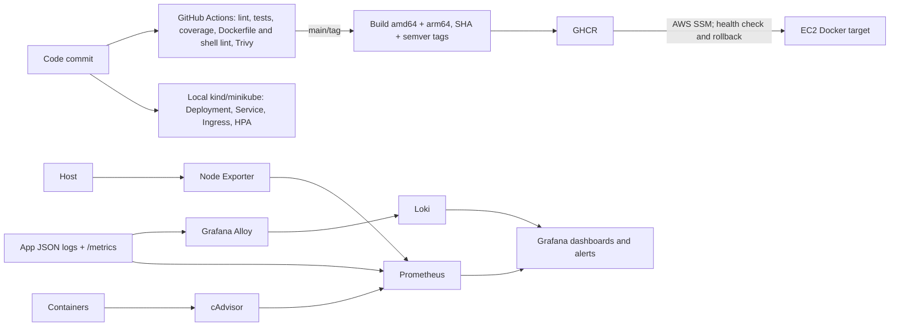

# DevOps Engineer Assessment

A reproducible reference implementation for the take-home task. It includes a FastAPI service, hardened container, CI workflows, Terraform for a small EC2 target, Kubernetes manifests, a Docker Compose monitoring stack, and a Linux health check. Cloud deployment and screenshots need to be produced in the reviewer's own accounts; this repository does not claim an AWS apply or live deploy.

## Architecture



## Prerequisites

- Docker Engine with Compose v2; Python 3.13 for tests and local development.
- For cloud deployment: Terraform 1.7+, AWS CLI, an AWS account, and a GitHub repository with Actions enabled.
- For Kubernetes: kind or minikube, kubectl, metrics-server, and optionally ingress-nginx.

## Run locally

```sh
cp .env.example .env
# Replace GRAFANA_PASSWORD with a local secret before starting the monitoring stack.
docker compose -f docker-compose.monitoring.yml up --build -d
curl -fsS http://localhost:8080/health
```

The app is at `http://localhost:8080`; Grafana is at `http://localhost:3000` (credentials from `.env`). Prometheus, Loki, Alloy, Node Exporter, and cAdvisor are attached only to the internal Compose network. Provisioned dashboards are available under Dashboards. The monitoring compose file is the full local stack and includes the app; `docker-compose.yml` is the simpler app-only setup.

The development run and test commands are:

```sh
python -m venv .venv && . .venv/bin/activate
pip install -r requirements-dev.txt
uvicorn app.main:app --host 127.0.0.1 --port 8080
pytest --cov=app --cov-report=term-missing
```

## Application and container

`GET /` returns the assessment greeting and configured version. `GET /health` is a lightweight liveness/readiness endpoint. `GET /metrics` exports Prometheus counters and a latency histogram. Configuration is read from `PORT`, `LOG_LEVEL`, `ENVIRONMENT`, and optional `APP_VERSION`; logs are JSON on stdout and Uvicorn receives SIGTERM and drains for up to 20 seconds.

The Dockerfile uses a two-stage build on pinned `python:3.13.1-alpine3.21`, drops privileges to an unprivileged user, and includes an OCI title/version/source, healthcheck and `.dockerignore`. The selected Python Alpine runtime is roughly 50–60 MB compressed before app layers (registry size varies by architecture); measure the exact artifact for your platform with `docker image inspect`/`docker images` rather than assuming an identical multi-arch size. Alpine is used here for a small image with a package manager available for debugging; a distroless image would reduce runtime surface further but complicates Python packaging and shell-based operations. Compose limits the app to 0.5 CPU and 256 MiB.

## CI/CD and secrets

Pull requests run Ruff, unit tests with coverage threshold, Hadolint, ShellCheck, a container build, and a Trivy scan that fails on fixed CRITICAL vulnerabilities. A main branch push builds and publishes both `sha-<commit>` and semantic version tags to GHCR with BuildKit cache, then uses SSM to deploy and check `/health`; a failed check restores the previous image. The AWS OIDC role and its trust policy are intended to be configured outside the repository; grant only `ssm:SendCommand`, `ssm:GetCommandInvocation`, and `ssm:DescribeInstanceInformation` for the target instance/document. Configure `AWS_ROLE_ARN` as a GitHub Actions variable and `AWS_REGION`, `DEPLOY_INSTANCE_ID` as variables, and `AWS_ROLE_ARN`; the release workflow uses GitHub OIDC (`id-token: write`) and `aws-actions/configure-aws-credentials`. Create `/devops/ghcr-read-token` as an SSM Parameter Store `SecureString` containing a narrowly scoped GHCR read:packages token before applying Terraform. The EC2 instance role reads it at deploy time, so the token is never included in an SSM command. Rotate it and prefer ECR with instance-role authentication for production. Registry publication itself uses the ephemeral `GITHUB_TOKEN`.

Terraform's EC2 instance role grants SSM managed-instance access and CloudWatch log stream writes. The bootstrap's GHCR pull requires a read-only package credential; for production, use a private ECR repository and scoped instance role rather than passing a registry token. Never commit credentials or `.env` files. GitHub variables and short-lived OIDC credentials avoid static AWS keys.

## Terraform

Remote state must be bootstrapped before Terraform init: create a unique S3 bucket with versioning and encryption, then use `-backend-config=backend.example.hcl` after replacing its bucket. Terraform S3 native lockfiles (`use_lockfile = true`) provide state locking. Keep state access restricted to the operator role.

```sh
cd terraform
cp backend.example.hcl backend.hcl  # edit bucket name
terraform init -backend-config=backend.hcl
terraform plan -var='environment=staging' -var='allowed_cidrs=["YOUR_IP/32"]' -var='image=ghcr.io/OWNER/REPO:TAG'
terraform apply -var='environment=staging' -var='allowed_cidrs=["YOUR_IP/32"]' -var='image=ghcr.io/OWNER/REPO:TAG'
# After collecting requested evidence:
terraform destroy -var='environment=staging' -var='allowed_cidrs=["YOUR_IP/32"]' -var='image=ghcr.io/OWNER/REPO:TAG'
```

Use `environment=production` for the second environment, with separate backend keys/state and a tighter ingress CIDR. The example opens HTTP only to configured CIDRs; SSM is used for administration instead of SSH. CloudWatch retention is 14 days. Production cost depends on region and traffic; a continuously running t3.micro is typically about $7–10/month compute, plus a public IPv4 address (about $3.65/month), 8 GiB gp3 storage (~$0.65/month), logs/egress, and state storage. Budget roughly $15–25/month before substantial traffic, and verify current regional pricing before provisioning.

## Kubernetes

```sh
kind create cluster
kubectl apply -f k8s/app.yaml
kubectl rollout status deployment/devops-app
kubectl port-forward service/devops-app 8080:80
```

Replace `ghcr.io/OWNER/REPO:TAG` with the immutable built tag. The placeholder Secret has no real secret value; remove it if the service needs none, or create a secret through your secret manager (`kubectl create secret`, Sealed Secrets, or External Secrets) and reference it with `envFrom`. Do not store secret data in version control. Install metrics-server for HPA and ingress-nginx if using the `devops.local` ingress host; port-forward is the documented alternative.

For a zero-downtime version change, update the image to the next immutable tag and run `kubectl rollout status deployment/devops-app`; for rollback, run `kubectl rollout undo deployment/devops-app` and confirm status. The two-replica deployment uses `maxUnavailable: 0`, readiness/liveness probes, requests/limits, a non-root identity, dropped capabilities and a read-only root filesystem. On EKS, use AWS Load Balancer Controller or another managed ingress, External Secrets Manager/Parameter Store, IRSA (or EKS Pod Identity), managed node groups/Karpenter autoscaling, and a private image registry. The manifests are local-cluster focused; production would also need TLS, network policies, disruption budgets and image policy enforcement.

## Observability

The required six components are included and pinned in `docker-compose.monitoring.yml`: Prometheus (15-day retention), Grafana, Loki (7-day retention), Alloy, Node Exporter and cAdvisor. Grafana alone exposes a monitoring UI port on the host. Node Exporter mounts host `/`, `/proc`, and `/sys` read-only to report host metrics; cAdvisor is privileged and mounts rootfs, Docker runtime state, sysfs, and device metadata read-only because it needs kernel/container inspection. These broad host mounts are for local assessment only; production monitoring should use an appropriately isolated agent deployment. Alloy reads Docker metadata/logs through the read-only Docker socket (socket access remains powerful) and parses JSON. It indexes only stable low-cardinality fields (`level`, `path`, service/container); it deliberately avoids request IDs, user IDs, query strings, and arbitrary values as labels.

The three provisioned dashboards are `Application`, `Host`, and `Containers`. The Application dashboard includes request/error rate, p50/p95/p99 latency and an adjacent Loki error log panel. Use the error-rate panel to identify when errors started, compare endpoint and latency panels, then filter the Loki panel by time and `level="ERROR"`/path to inspect structured status and duration. Correlate with container restarts and host/container resource panels. Exported dashboard JSON is in `monitoring/grafana/dashboards/`; provisioning avoids manual UI setup. In a running stack, capture screenshots from each dashboard here before submission.

Alerts use: app target down for 2m (prompt detection with scrape-transient tolerance); error ratio above 5% for 5m (filters short blips while catching user-visible failures); disk use above 80% for 10m (allows cleanup/rotation before exhaustion); and container memory above 90% of limit for 5m (headroom before OOM termination). Thresholds should be tuned against workload baselines.

## Linux system health script

```sh
sudo install -m 0755 scripts/system_health.sh /usr/local/bin/system_health.sh
/usr/local/bin/system_health.sh --help
/usr/local/bin/system_health.sh --disk 80 --cpu 90 --mem 85
/usr/local/bin/system_health.sh --json
```

It reports CPU, memory, all mounted filesystems, load and top five memory processes; appends to a timestamped log, rotates at 1 MiB, supports JSON and exits 0 healthy, 1 warning, 2 invalid configuration/critical invocation error. Install `systemd/system-health.service` and `.timer` to run every five minutes (`systemctl enable --now system-health.timer`).

## Design decisions

- A small FastAPI service keeps focus on platform concerns while providing meaningful metrics and JSON logs.
- EC2 is the simplest requested production target and can be low-cost; ECS would reduce host operations, while EKS is more capability and cost than this workload requires.
- Immutable SHA tags identify exact commits; semantic tags support human releases. `latest` is not used as a deployment reference.
- Local Compose uses environment-based Grafana credentials; cloud identity relies on OIDC and instance roles, not long-lived AWS keys.
- Logs use bounded path/status dimensions and no sensitive or unbounded identifiers as metric labels.

## Security considerations

CI scans images and rejects CRITICAL findings; pin actions and images further by digest for a hardened production supply chain. AWS access is via scoped IAM and SSM; security group ingress is caller-configured. No SSH is exposed. GHCR package pull credentials need replacement with ECR/instance-role access for a private production image. Grafana credentials are supplied from `.env`; keep it untracked. Kubernetes runs as non-root with read-only root FS; secret material must be injected externally.

## What I would improve with more time

Add SLSA provenance, Cosign signing and SBOM upload, a real staging gate and approval environment, integration tests against Compose, Terraform tests and a dedicated state bootstrap module, a private ECR migration with instance-role pulls, a Kubernetes PDB/NetworkPolicy, alert routing, and recorded dashboards/screenshots from a live run. Validate the AWS budget with the selected region and expected log/egress volume.

## AI use

AI assistance was used to draft and assemble the initial implementation and documentation.


# Issues faced and fixed:
- monitoring setup didn't work as app service was in another network.
- grafana panels didn't show data as prometheus setup wasn't complete with alloy integration.
- github ci failed due to `ruff` linting. Fixed by: `ruff check --fix` command.
